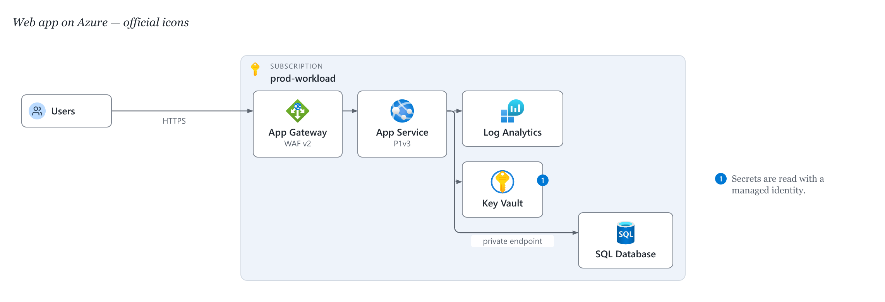
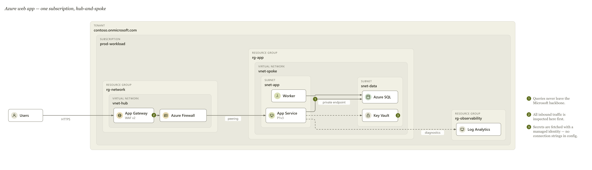
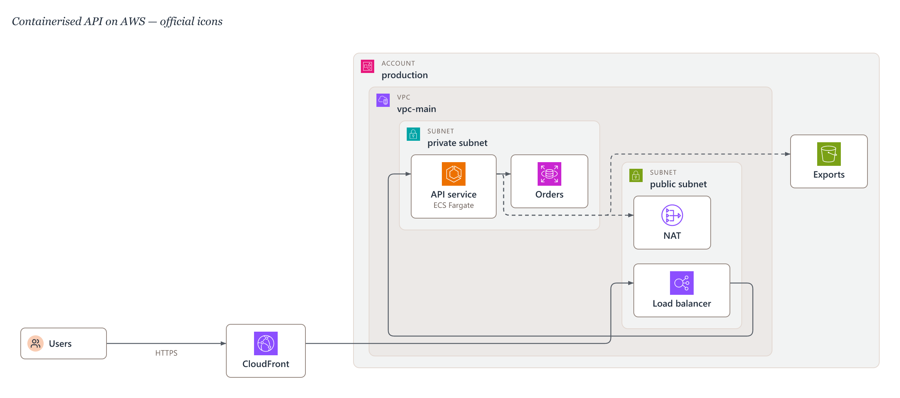

# diagrams-maker

**Declarative, interactive diagrams in the [Distill.pub](https://distill.pub) style.** Write a small YAML file and get an
**interactive SVG** (hover/click highlighting, animated flow, step-by-step reveal, tooltips), a **static PNG**, or a
`<Diagram />` for **MDX / React** sites. Built for cloud architecture (Azure / AWS tenants, subscriptions, accounts, VNets/VPCs,
subnets, resources and their interactions), flowcharts and ER models — and fully themeable, so diagrams match *your* brand.



<p align="center"><em>Same engine, your own look:</em></p>



## Agents + Skill + MCP — the best way to use it

diagrams-maker ships everything an AI assistant needs to draw diagrams **well**, not just quickly:

| Piece | What it gives the assistant |
|---|---|
| **MCP server `dgm`** (`packages/mcp`) | Tools to search icons, validate, **render a PNG it can look at and iterate on**, save specs, create and preview themes |
| **Skill `diagram-author`** (`skills/diagram-author`) | The know-how: workflow, spec rules, Azure/AWS patterns, a style checklist |
| **Agent `diagram-specialist`** (OpenCode) + `/diagram`, `/diagram-theme` | One agent that owns the whole job: takes text, project files or reference images, asks only what it must, and delivers spec + PNG + SVG |

Works with **Claude Code** and **OpenCode** out of the box (open this repo after `npm run build`), and with any MCP client.
Setup for each client: [docs/agents.md](docs/agents.md).

## No AI? It's declarative — use it by hand

You do not need an assistant. A diagram is a plain text file; the CLI validates and renders it:

```yaml
# hello.diagram.yaml
type: architecture
title: Hello, diagrams
nodes:
  - { id: users, label: Users, icon: lu-users }
  - id: app
    label: Platform
    kind: cloud
    children:
      - { id: api, label: API, icon: lu-server }
      - { id: db, label: Database, icon: lu-database }
edges:
  - { from: users, to: api, label: HTTPS, flow: true }
  - { from: api, to: db, label: SQL }
```

```bash
npm install && npm run build

node packages/cli/dist/index.js validate hello.diagram.yaml        # errors/warnings with fixes
node packages/cli/dist/index.js render hello.diagram.yaml -o hello.svg    # interactive SVG
node packages/cli/dist/index.js render hello.diagram.yaml -o hello.png --theme olive   # static PNG
node packages/cli/dist/index.js schema                              # full JSON Schema of the spec (editor autocompletion)
```

Everything else is the same text format: [`examples/`](examples) has ready-to-copy specs (architecture, flow, ER),
[`docs/`](docs) explains [themes](docs/themes.md), [layout and phone variants](docs/layout.md) and [icons](docs/icons.md).
`dgm kinds` lists the node kinds and `dgm icons search <text>` finds icon names.

> Windows PowerShell: use `;` instead of `&&`.

## Use it in a site (MDX / React / Astro)

```mdx
import arch from "./arch.diagram.yaml";
import { Diagram } from "@dgm/react";

<Diagram client:visible svg={arch} caption="Figure 1. Architecture." />
```

`@dgm/react` includes a Vite plugin that turns `*.diagram.yaml` imports into specs. A complete Astro + MDX example lives in
[`site-demo/`](site-demo) (`npm run demo:dev`).

## Packages

| Package | What |
|---|---|
| `@dgm/core` | spec, ELK layout, SVG renderer, themes, icons, PNG export |
| `@dgm/cli` | `dgm render / validate / schema / kinds / theme / icons / skill / agent / mcp` |
| `@dgm/react` | `<Diagram />` for MDX + Vite plugin |
| `@dgm/mcp` | MCP server for AI agents |
| `skills/diagram-author` | Skill: workflow, patterns, style guide |

> **Not on npm yet.** For now, clone the repo and run `npm install && npm run build` (Node ≥ 22).

## Icons

- **Lucide** (`lu-*`, 2400+ icons) is bundled — works immediately.
- **Official Azure / AWS icons** are *not* included. Download the zips from the official sites, drop them in
  `icons-inbox/<pack>/` and run `dgm icons update` (one step, details in [docs/icons.md](docs/icons.md)). The examples
  [`azure-icons`](examples/azure-icons.diagram.yaml) and [`aws-icons`](examples/aws-icons.diagram.yaml) need them;
  rendered results are in [`docs/img/`](docs/img).
- Bring your own pack: any folder of SVGs registered in `dgm.config.json`.



## Contributing

Issues and pull requests are welcome — see [CONTRIBUTING.md](CONTRIBUTING.md). Report security problems privately
([SECURITY.md](SECURITY.md)).

## License and notices

MIT © 2026 Vicente Jorquera — see [LICENSE](LICENSE). Keep the copyright notice in copies and derivative works.
Third-party notices: [NOTICE.md](NOTICE.md) (Lucide icons, dependencies).

**This project is not affiliated with, sponsored by, or endorsed by Microsoft, Amazon Web Services or Distill.**
Azure, Microsoft, AWS and Amazon are trademarks of their owners; the images above only illustrate diagrams made with their
publicly offered icons. Details: [ICONS-DISCLAIMER.md](ICONS-DISCLAIMER.md).
